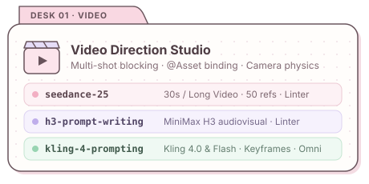
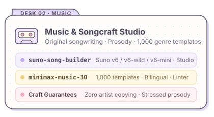

<div align="center">


# ✦ Creative AI Skills Studio ✦

**From a creative brief to a structured, paste-ready video or music prompt.**

*Video direction · Multimodal reference workflows · Original songwriting · Deterministic prompt validation*

<p>
  <a href="#choose-a-skill"></a>
  <a href="#choose-a-skill"></a>
  <a href="#validation"></a>
  <a href="LICENSE"></a>
</p>

A curated studio collection by **[glitterpixely](https://github.com/glitterpixely)**, built for directing video and music models through any AI assistant.

[**Studio Desks**](#studio-desks) · [**Choose a Skill**](#choose-a-skill) · [**Model Guides**](#model-guides--research-lineage) · [**Install**](#installation) · [**Sample Briefs**](#example-briefs) · [**Validators**](#validation) · [**Contribute**](CONTRIBUTING.md)


</div>

## Studio Desks

Five focused skills for turning ideas, scripts, character sheets, and audio references into structured video and music prompts. Each skill pairs a step-by-step directing workflow with model-specific references and standalone validators.

<div align="center">
  <a href="#video-direction-skills"></a>
  &nbsp;
  <a href="#music--songcraft-skills"></a>
</div>

- **Direct the scene:** define physical action, camera trajectory, timing, reference bindings (`@Image`, `@Video`, `@Audio`), and continuity locks.
- **Shape the song:** develop an original premise, prosody-checked lyrics, vocal posture, focal instrumentation, and dynamic arrangement arcs.
- **Refine the result:** diagnose a rendered clip or track by failure layer and apply targeted single-variable or section-level repairs.
- **Check the prompt:** run the zero-dependency Python 3 linters before generation to catch structural or reference-binding errors early.

<div align="center">
  
</div>

## Choose a Skill

Start with the model you plan to generate in. Open its `SKILL.md` for the core routing protocol, then load only the references needed for your task.

### Video Direction Skills

| Skill | Target Model & Best Use | Key References | Automated Checks |
| --- | --- | --- | --- |
| **[`seedance-25`](seedance-25/SKILL.md)** | **Seedance 2.5** — Multi-shot video generation (4–30s & 30–180s Long Video), up to 50 `@` references, storyboards, localized edits, and extensions | [`prompt-architecture.md`](seedance-25/references/prompt-architecture.md), [`task-contracts.md`](seedance-25/references/task-contracts.md), [`desk-prompt-patterns.md`](seedance-25/references/desk-prompt-patterns.md) | [`prompt_lint.py`](seedance-25/scripts/prompt_lint.py), [`validate_coverage.py`](seedance-25/scripts/validate_coverage.py) |
| **[`h3-prompt-writing`](h3-prompt-writing/SKILL.md)** | **MiniMax H3** — Audiovisual scene direction, first/last frame interpolation, multimodal `@` asset binding, and delta-only video edits | [`model-contract.md`](h3-prompt-writing/references/model-contract.md), [`official-hosted-prompt-guide.md`](h3-prompt-writing/references/official-hosted-prompt-guide.md), [`omni-reasoning-research.md`](h3-prompt-writing/references/omni-reasoning-research.md) | [`lint_h3_prompt.py`](h3-prompt-writing/scripts/lint_h3_prompt.py), [`validate_coverage.py`](h3-prompt-writing/scripts/validate_coverage.py) |
| **[`kling-4-prompting`](kling-4-prompting/SKILL.md)** | **Kling 4.0 & Flash** — Text-to-video, image animation (`I2V`), start/end keyframes, Omni reference binding, and render diagnosis | [`capabilities.md`](kling-4-prompting/references/capabilities.md), [`prompt-patterns.md`](kling-4-prompting/references/prompt-patterns.md), [`kling-architecture-research.md`](kling-4-prompting/references/kling-architecture-research.md) | Built-in verification gate in [`SKILL.md`](kling-4-prompting/SKILL.md) |

### Music & Songcraft Skills

| Skill | Target Model & Best Use | Key References | Automated Checks |
| --- | --- | --- | --- |
| **[`suno-song-builder`](suno-song-builder/SKILL.md)** | **Suno v6 (`v6`, `v6-wild`, `v6-mini`)** — Original songs, hooks, stressed-meter lyrics, film/game scores, `Max Mode` / `Variety` calibration, natural-language edits, and Suno Studio workflows | [`songcraft.md`](suno-song-builder/references/songcraft.md), [`suno-controls.md`](suno-song-builder/references/suno-controls.md), [`controllable-song-research.md`](suno-song-builder/references/controllable-song-research.md) | 7-block schema & originality gate in [`SKILL.md`](suno-song-builder/SKILL.md) |
| **[`minimax-music-30`](minimax-music-30/SKILL.md)** | **MiniMax Music 3.0** — 8-layer `Caption` design, section-tagged `Lyrics`, instrumental cues, and **1,000 bilingual genre templates** (`100 genres × 10 variants`) | [`genre-router.md`](minimax-music-30/references/genre-router.md), [`prompt-architecture.md`](minimax-music-30/references/prompt-architecture.md), [`music-generation-research.md`](minimax-music-30/references/music-generation-research.md) | [`lint_music_prompt.py`](minimax-music-30/scripts/lint_music_prompt.py), [`validate_coverage.py`](minimax-music-30/scripts/validate_coverage.py) |

<div align="center">
  
</div>

## Model Guides & Research Lineage

<details open>
<summary><strong>🎬 Seedance 2.5 Guide & ByteDance Seed Research Summary</strong></summary>
<br />

The [`seedance-25`](seedance-25/SKILL.md) skill combines first-party capability rules ([`source-boundaries.md`](seedance-25/references/source-boundaries.md), [`prompt-architecture.md`](seedance-25/references/prompt-architecture.md), [`task-contracts.md`](seedance-25/references/task-contracts.md), [`optimizer-runtime.md`](seedance-25/references/optimizer-runtime.md)) with field-tested directing craft and architecture notes ([`desk-prompt-patterns.md`](seedance-25/references/desk-prompt-patterns.md)).

### Core Envelope & Duration Rules

- **Duration:** **30 seconds** by default (`Standard` mode, 4–30s single-pass generation). Dreamina web also exposes a **Long Video** mode (**30–180 seconds**) when explicitly requested (`--long-video` in `prompt_lint.py`). Multi-clip segmentation plans remain available for multi-call workflows above 30s.
- **Multimodal references:** Up to **50 total assets** per request (up to 30 images, 10 videos totaling $\le$30s, and 10 audio clips totaling $\le$30s) bound with explicit roles (`@Image 1`, `@Video 1`, `@Audio 1`) and `[Unused Materials]` exclusions.
- **Primary operations:** One operation per prompt—**Generation** (including keyframes, storyboards, 3D blockouts, one-click, and seamless transitions), **Editing** (`@Video 1 is the sole editing master`), or **Extension** (`Extend @Video 1 forward/backward`). Never phrase an editing master or extension source as `"Reference @Video 1"` (`参考 <视频1>`), which misroutes the job to ordinary reference generation.
- **Cost-aware workflow:** Validate multi-shot blocking in **Draft Mode** (`draft=true` / 480p preview) before promoting the seed to 1080p/4K (`draft=false`), and use **localized time-window editing (`局部重拍`)** to repair a 2–4s flaw rather than re-rolling a full 30s clip.

### ByteDance Seed Research Lineage & Prompting Implications

| Paper | arXiv ID | Core Mechanism | What It Means for Prompts |
| --- | --- | --- | --- |
| **Seedance 1.0** | [`2506.09113`](https://arxiv.org/abs/2506.09113) | Decoupled spatial/temporal DiT + **Multi-Shot MM-RoPE** + native cut-boundary pre-training | Explicit `Shot N` labels and cut counts (`受控多段序列`) trigger learned hard-cut transitions inside a single pass. |
| **Seedance 1.5 Pro** | [`2512.13507`](https://arxiv.org/abs/2512.13507) | **Dual-Branch MMDiT** joint audio-video co-denoising + >10$\times$ distillation | Sound effects (`<...>`), ambience, and lip phonemes denoise simultaneously with video frames; concrete sound cues tighten visual timing. |
| **Seedance 2.0** | [`2604.14148`](https://arxiv.org/abs/2604.14148) | Unified multi-modal backbone across text, `@image`, `@video`, and `@audio` | Give each reference asset one non-overlapping job (`identity` vs. `environment` vs. `motion` vs. `voice`). |
| **Phantom** | [`2502.11079`](https://arxiv.org/abs/2502.11079) | Cross-modal alignment on non-frame text-image-video triplets (`Phantom-Data`) | Exclude both background and static pose on portrait references (`do not copy its background or static standing pose`) to prevent pose leakage. |
| **HuMo** & **OmniHuman-1** | [`2509.08519`](https://arxiv.org/abs/2509.08519), [`2502.01061`](https://arxiv.org/abs/2502.01061) | **Time-Adaptive CFG** (layout/camera early; `@Image` identity & `@Audio` lip-sync late) | Front-load the 180° stage map and camera move in clause 1; allow `0–1s` for geometry to settle; add **rhythm carriers** (breathing, weight shift) so speaking bodies do not freeze. |
| **RewardDance** & **VideoReward** | [`2509.08826`](https://arxiv.org/abs/2509.08826), [`2501.13918`](https://arxiv.org/abs/2501.13918) | 26B VLM reward judge with Chain-of-Thought verification & Flow-DPO | Write beats as verifiable state checklists (`entry state -> physical action -> observable exit state`) rather than mood adjectives. |
| **Tarsier2** | [`2501.07888`](https://arxiv.org/abs/2501.07888) | 40M fine-grained chronological video captioner | Keep actions in strict forward chronological order (`[camera] + [actor + action] + [environment response]`); avoid literary metaphors (`意识流`). |
| **Seaweed-7B**, **APT**, & **AAPT** | [`2504.08685`](https://arxiv.org/abs/2504.08685), [`2501.08316`](https://arxiv.org/abs/2501.08316), [`2506.09350`](https://arxiv.org/abs/2506.09350) | Causal 3D VAE, 1-step Adversarial Post-Training, and KV-cached sliding-window attention | Powers low-cost `Draft` previews and 30s horizon stability; re-tag characters (`Name, 2-word trait`) after cuts or heavy occlusion so they re-bind inside the active attention window. |

### 6-Part Multi-Shot Continuity Formula

For complex multi-shot clips, [`desk-prompt-patterns.md`](seedance-25/references/desk-prompt-patterns.md#multi-shot-continuity-craft) codifies a reusable 6-part structure:

1. **Reference & character header:** Visual traits + limb/accessory left-right asymmetry locks (`white mechanical right arm; hip holster stays empty`) + starting hand/inventory state (`arrives empty-handed`).
2. **Visual style + energy/physics locks:** Medium and palette (keeping 2D layer grammar free of live-action bokeh/DOF terms), anti-slide footwork (`feet always plant, push, leap, or roll, never slide`), and sub-object material physics.
3. **Avoid block:** Concise hard exclusions (`no subtitles, no BGM, no extra foreground characters, no fade-out`) checked for self-contradiction against the body.
4. **Global premise & 180° stage map:** 1-sentence story summary + `screen left / screen right` landmark coordinates + `air between bodies` depth separation.
5. **Scene header:** Continuity mode, speed/time state, and scene-scoped visual/audio shifts.
6. **Shot breakdown (`Shot N`):** Camera framing & move in clause 1 $\rightarrow$ per-shot prop state restatement $\rightarrow$ causal `A -> B -> C` action chain with 2-word character anchors (`Kira, lilac buns`) $\rightarrow$ isolated speaker + closed-mouth listeners ($\le$2.5 words/s) $\rightarrow$ kinetic `Cut as <active motion>` trigger.

### Automated Checks in `seedance-25/scripts/prompt_lint.py`

In addition to material limits, reference role bindings, timeline gaps/overlaps, and mode contracts, `prompt_lint.py` checks for:

- `DIALOGUE_DENSITY` — warns when a timed shot exceeds $\ge$3.0 spoken Latin-script words per second.
- `NEGATION_CONFLICT` — catches contradictions between `Avoid` bans (`no freeze frames`, `no slow motion`) and body instructions (`hit-stop`, `定格`, `speed ramp`, `子弹时间`).
- `EDIT_REFERENCE_TRAP` — warns if an edit or extension prompt phrases the master/source video as `Reference @Video N` (`参考 <视频N>`).
- `MORPH_TOKEN_RISK` — flags non-negated `变形` / `morph into` / `shape-shift into` in generation prompts in favor of `闪切` (`flash-cut`).
- `STYLE_2D_LENS_CONFLICT` — flags 2D cel/hand-drawn/gouache prompts mixed with live-action bokeh or shallow-DOF lens terms.
- `UNSUPPORTED_HANDLE_SYNTAX` — catches un-normalized wrapper/dump tokens (`<<<Image1>>>`, `@[ref]`, `<视频1>`).

</details>

<details>
<summary><strong>🎥 MiniMax H3 &amp; Kling 4.0 Video Direction Highlights</strong></summary>
<br />

- **MiniMax H3 ([`h3-prompt-writing`](h3-prompt-writing/SKILL.md)):**
  - Enforces a 5-stage causal spine (**Reference Mapping $\rightarrow$ Anchor Scene $\rightarrow$ Causal Motion Chain $\rightarrow$ Camera Trajectory $\rightarrow$ Synchronized Soundscape**) and a "state every inference" rule drawn from an independent 517-instance physical-reasoning benchmark of H3 (41.97% overall success on implicit prompts; [`omni-reasoning-research.md`](h3-prompt-writing/references/omni-reasoning-research.md)).
  - Separates first/last-frame interpolation bridges from delta-only video edits (`Keep ... unchanged; change only ...`).
- **Kling 4.0 & Flash ([`kling-4-prompting`](kling-4-prompting/SKILL.md)):**
  - Selects deterministically between Text-to-Video, Image-to-Video (`I2V`), Start/End Keyframes, and Omni Multi-Reference workflows ([`kling-architecture-research.md`](kling-4-prompting/references/kling-architecture-research.md)).
  - Reduces "talking statue" failure modes in `I2V` by omitting redundant static portrait descriptions and specifying concrete physical weight transfers and micro-motions.

</details>

<details>
<summary><strong>🎧 Suno v6 &amp; MiniMax Music 3.0 Songcraft Highlights</strong></summary>
<br />

- **Suno v6 ([`suno-song-builder`](suno-song-builder/SKILL.md)):**
  - Supports the **Suno v6 model family** (`v6` flagship, `v6-wild` exploration, `v6-mini` for all users), **`Max Mode`** (extra credits; Suno recommends it for songs over two minutes, close covers, and style transfer), and **`Variety` at `0`** to keep full control of style tags ([`suno-controls.md`](suno-song-builder/references/suno-controls.md)).
  - Integrates **v6 natural-language song editing** (plain-text section, ensemble, or single-word lyric swaps) and **Suno Studio** finishing (Clip Settings, semitone+cent fine pitch, Auto-Stretch, and 12-stem export).
- **MiniMax Music 3.0 ([`minimax-music-30`](minimax-music-30/SKILL.md)):**
  - Provides **1,000 bilingual production templates** across 100 genres ([`templates/`](minimax-music-30/templates)) plus an 8-layer `Caption` formula and stressed-meter `Lyrics` validator ([`lint_music_prompt.py`](minimax-music-30/scripts/lint_music_prompt.py)).

</details>

<div align="center">
  
</div>

## Installation

Every skill uses the portable `SKILL.md` + `references/` + `scripts/` layout and plain-text Markdown, so it works with **any AI coding agent, desktop assistant, IDE, or chat interface**.

### 1. Any Agent with a Local `skills/` Directory

Clone this repository:

```bash
git clone https://github.com/glitterpixely/skills.git
cd skills
```

Copy the skill folder you want (or symlink/clone the repository) into your agent's skills directory:

| Agent / Environment | Typical Skills Path |
| --- | --- |
| **Antigravity** | `~/.gemini/config/skills/<skill>` |
| **Claude Code** | `~/.claude/skills/<skill>` |
| **Codex** | `${CODEX_HOME:-$HOME/.codex}/skills/<skill>` |
| **Hermes** | `${HERMES_HOME:-$HOME/.hermes}/skills/<skill>` |
| **OpenCode / Cursor / Other** | Your configured local `skills/` directory |

Example copy command (set `skills_dir` to your agent's path):

```bash
skill="seedance-25"
skills_dir="$HOME/.gemini/config/skills"
mkdir -p "$skills_dir"

# Preserve an existing installation instead of overwriting it.
if [ -e "$skills_dir/$skill" ]; then
  printf 'Already installed: %s\nBack up the existing folder before replacing it.\n' "$skills_dir/$skill"
else
  cp -R "./$skill" "$skills_dir/$skill"
fi
```

Copy the **entire skill folder** so that `references/`, `templates/`, and `scripts/` remain available alongside `SKILL.md`. To update later, run `git pull --ff-only` in the cloned repository and refresh your installed copy.

### 2. Any Chat UI, Project, Gem, or Custom GPT

No CLI or agent runtime is required:

1. Upload or attach the skill's `SKILL.md` file (and the relevant files from `references/`) to your **Claude Project**, **Gemini Gem**, **ChatGPT Custom GPT**, or directly into a chat thread.
2. Give your brief in plain language—the assistant will follow the workflow and rules in `SKILL.md`.

<div align="center">
  
</div>

## Example Briefs

These prompts work in any assistant once the relevant skill is loaded or attached:

**🌸 A small visual story (`seedance-25`)**

```text
Using the seedance-25 skill, write a 15-second video prompt.
A tiny witch tries to lift a fallen star into her wheelbarrow.
One character, one garden setting, one clear visual payoff.
Use a gentle camera move, preserve a storybook look, and include no music.
```

**🦋 A reference-led character moment (`kling-4-prompting`)**

```text
Using the kling-4-prompting skill, animate my attached character image.
Preserve the face, outfit, and illustration style. The character notices
a glowing moth, reaches toward it, and smiles as it lands on one finger.
Keep the action readable and list any generation settings separately.
```

**🍵 An original song direction (`suno-song-builder`)**

```text
Using the suno-song-builder skill, develop an original indie-pop song for Suno v6
about finding your confidence again. Warm vocals, tactile percussion,
and a chorus that feels hopeful without becoming grandiose.
Give me a style prompt and complete lyrics in separate paste-ready blocks.
```

For MiniMax Music, the [genre guide](minimax-music-30/references/genre-router.md) helps you navigate the [1,000-template library](minimax-music-30/templates). Adapt a template to the song’s premise, vocal character, and arrangement.

<div align="center">
  
</div>

## Repository Layout

```text
skills/
├── AGENTS.md                  # Repository automation & sync conventions
├── CONTRIBUTING.md            # Contribution & validator checklist
├── LICENSE                    # MIT License
├── README.md                  # Studio overview & quick-start guide
├── assets/                    # Pastel stationery banner, cards, & badges
├── seedance-25/               # Seedance 2.5 video directing & linter
├── h3-prompt-writing/         # MiniMax H3 audiovisual directing & linter
├── kling-4-prompting/         # Kling 4.0 & Flash video directing
├── minimax-music-30/          # MiniMax Music 3.0 + 1,000 templates & linter
└── suno-song-builder/         # Suno v6 songwriting, controls, & Studio workflow
```

Inside each skill:

| Path | Purpose |
| --- | --- |
| `SKILL.md` | Main instructions and deterministic routing workflow (portable across all agents) |
| `references/` | Supporting craft guidance, academic foundations, examples, and capability notes |
| `scripts/` | Python 3 validation helpers (standard library only, zero third-party dependencies) |
| `templates/` | 1,000 bilingual music prompt templates (`100 genres × 10`), in `minimax-music-30` |
| `agents/openai.yaml` | Optional display metadata for runtimes that read it |

## Validation

The Seedance, H3, and MiniMax Music skills include standalone Python 3 prompt linters and repository coverage validators (using only the Python standard library):

```bash
# Prompt linters
python3 seedance-25/scripts/prompt_lint.py --help
python3 h3-prompt-writing/scripts/lint_h3_prompt.py --help
python3 minimax-music-30/scripts/lint_music_prompt.py --help

# Skill coverage & self-test suites
python3 seedance-25/scripts/validate_coverage.py
python3 h3-prompt-writing/scripts/validate_coverage.py
python3 minimax-music-30/scripts/validate_coverage.py
```

Follow the chosen skill’s instructions for the correct mode, duration, input files, or runtime surface. A passing prompt check establishes structural compliance; the generated video or song still needs visual or listening review.

## Scope & Maintenance

These skills provide prompting guidance and local validation helpers. Generation runs in the relevant creative platform or runtime, using your own access. Capability notes record their sources and boundaries; check those references when a model version, interface, or feature changes.

Found a broken reference, an outdated capability, or a useful improvement? [Open an issue](https://github.com/glitterpixely/skills/issues) or see the [contribution guide](CONTRIBUTING.md).

## License

Released under the [MIT License](LICENSE).

<div align="center">
  <br />
  
</div>
