> Part of the `threejs-rendering` skill. Verified against three r187 (2026-10-31); re-check version gates in `00-version-gates.md` for newer releases. `§n` refers to reference file `0n-…`.

# 5. Cinematic post-processing pipeline

### 5.1 Choosing a stack

| | pmndrs `postprocessing` v6 (WebGLRenderer) | Native `RenderPipeline` + TSL (WebGPURenderer) |
|---|---|---|
| Merging | `EffectPass` compiles several effects into **one fullscreen shader**, which saves bandwidth | A node graph compiled per output: fusable math nodes inline; effects with their own render targets (bloom, DOF, AO, SSR, TRAA) run as separate passes |
| G-buffer | `NormalPass`/depth; limited MRT | First-class MRT: `scenePass.setMRT( mrt( { output, normal, metalrough, emissive, velocity, diffuseColor } ) )`, packable to 8-bit |
| AO | N8AO (`N8AOPostPass`), `SSAOEffect` | `ao()` GTAO, `ssao()`, `ssgi()`; **AO can be injected into indirect lighting only** via `builtinAOContext` |
| Reflections | No maintained SSR in v6 core | `ssr()`: mirror + stochastic GGX, env fallback, denoiser |
| Temporal AA | No core TAA in v6 | `traa()`, `taau()` (temporal upscaling), `fsr1` |
| Status on r187 | Peer range `<0.187.0` (§0) | First-party, versioned with three |

**Decision rule:** new photoreal projects on r183+ use `WebGPURenderer` + `RenderPipeline`. It runs on WebGL2 too, via its fallback backend or `forceWebGL`. Existing WebGLRenderer apps keep pmndrs, pinned to a supported three version.

### 5.2 Execution order and why

Engine practice (*settled*): AO and GI belong in lighting, everything temporal comes before lens effects, and display-space effects come after tone mapping.

```mermaid
flowchart LR
  A["Prepass: depth, normal, velocity"] --> B["GTAO / SSGI (half res)"]
  B --> C["Scene pass: AO injected into indirect light"]
  C --> D["SSR composite (HDR, linear)"]
  D --> E["TRAA (resolve noise + AA)"]
  E --> F["Depth of field"]
  F --> G["Bloom (HDR, threshold on linear luminance)"]
  G --> H["Tone map + sRGB (renderOutput)"]
  H --> I["Chromatic aberration, vignette, film grain"]
  I --> J["SMAA/FXAA only if no TRAA"]
```



1. **Ambient occlusion.** AO must darken only *indirect* light. A post-multiply also darkens sun-lit surfaces, which gives dirty halos. TSL does this correctly with `scenePass.contextNode = builtinAOContext( aoTexture.sample( screenUV ).r )`, as in the r187 `webgpu_postprocessing_ao` example.
   - **GTAO** (`ao()`): `radius` in world units (default 0.25; use 0.2–0.5 m for interiors), `samples` 16, `resolutionScale = 0.5`, `useTemporalFiltering = true` **requires TRAA**. Set the scene pass to `options.samples = 0` when using TRAA.
   - **N8AO** (pmndrs): `aoRadius` in world units, about 1–2 orders of magnitude below scene size; `distanceFalloff = 1`; `intensity` 2 (subtle) to 5 (strong); `halfRes = true` keeps depth-aware upsampling; `setQualityMode('Medium')`; `accumulate = true` while the camera is still. Washed-out or too-dark output means `gammaCorrection` is set wrong for its position in the chain.
2. **Screen-space reflections** (`ssr( color, depth, normal, { metalnessNode, roughnessNode } )`): `quality` 0.5, `maxDistance` in world units, `thickness` 0.05–0.1, `resolutionScale` 0.5.
   - On misses and near screen edges, SSR fades to its own equirect `environmentNode` (CPU-side data texture, **not** PMREM), multiplied by `environmentIntensity` (default π), over `screenEdgeFade` 0.2.
   - `reflectNonMetals: true` makes marble, wood and plastic reflect.
   - `stochastic: true` produces glossy GGX reflections, but needs the temporal-reproject and denoise chain (`webgpu_postprocessing_ssr_denoise`).
   - The r187 examples composite **additively** (`scenePassColor.add( ssr.rgb )`). On hit pixels that stacks on top of the PMREM specular already in the beauty pass. Keep `intensity ≤ 1` on surfaces with strong IBL, or use SSR mainly on floors where IBL reflections are dim. *(Belief: a fully energy-correct swap needs a separate indirect-specular MRT; I did not find one documented.)*
   - Planar reflections: `Reflector` / `ReflectorNode` for one perfectly flat mirror or water plane. It re-renders the scene and costs about 2× draw calls.
3. **Depth of field** (thin-lens calibration).
   - Circle of confusion on the sensor, with focal length f, f-number N, focus distance S₁ and subject distance S₂:

$$c = \frac{f^{2}}{N}\cdot\frac{|S_2 - S_1|}{S_2\,(S_1 - f)} \qquad c_{\infty} = \frac{f^{2}}{N\,(S_1 - f)} \qquad c_{px} = \frac{c}{h_{film}}\cdot H_{px}$$

   - Three gives you f (`camera.getFocalLength()`, mm) and h_film (`camera.getFilmHeight()`, from `filmGauge` = 35 mm on the larger axis).
   - **Worked example** (computed): 50 mm, f/1.8, focus 2 m, 16:9 at 1080p gives c∞ = 0.712 mm = **39 px** diameter. Subjects at 3 m blur to 13 px, at 4 m to 19.5 px, at 1.5 m to 13 px. With c = 0.03 mm the hyperfocal distance is 46 m.
   - **Mapping to the APIs** (neither is a physical camera):
     - TSL `dof( color, viewZ, focusDistance, focalLength, bokehScale )`: CoC = `smoothstep( 0, focalLength, |viewZ − focus| )`. **The `focalLength` argument is a blur-ramp distance in metres, not the lens focal length.** Set `focusDistance = S₁`. Set `focalLength` = the distance behind focus at which your thin-lens c_px reaches about 80% of c∞. Tune `bokehScale` until the maximum blur matches c∞ in pixels.
     - pmndrs `DepthOfFieldEffect`: `focusDistance` and `focusRange` in world units (the `focalLength` option is deprecated), `bokehScale`, `resolutionScale` 0.5.
     - Both ramps are symmetric. Real near-field blur grows faster than far-field blur, so for macro shots bias the focus slightly toward the camera.
4. **Physically based bloom.** Bloom runs on **linear HDR before tone mapping**.
   - *Threshold mode* (what the brief asks for):
     - TSL `bloom( input, strength 0.15–0.4, radius 0.4–0.8, threshold 1.0 )`. Luminance high-pass with `smoothWidth` 0.01.
     - pmndrs `BloomEffect( { mipmapBlur: true, luminanceThreshold: 1.0, luminanceSmoothing: 0.03, intensity: 0.3–1, radius: 0.6–0.85, levels: 8 } )`. Needs `frameBufferType: HalfFloatType`, otherwise nothing exceeds 1.0.
     - Even tighter: bloom only the emissive MRT (`webgpu_postprocessing_bloom_emissive`: `mrt( { output, emissive: vec4( emissive, output.a ) } )`, then `bloom( emissivePass, … )`).
   - *Veiling-glare mode* (closer to a real lens): `threshold 0` and very low strength (0.02–0.05) on the whole frame. Every bright source glows in proportion to its energy, and nothing glows at a hard cut-off.
5. **Lens and sensor** (after tone mapping, display-referred):
   - `chromaticAberration( node, strength ≈ 0.3–1, center, scale 1.1 )` (TSL), or pmndrs `ChromaticAberrationEffect( { offset: new Vector2( 0.0006, 0.0006 ), radialModulation: true, modulationOffset: 0.15 } )`. Keep edge fringing to ≤ 1 px at 1080p.
   - Vignette: pmndrs `VignetteEffect( { offset: 0.3, darkness: 0.4–0.6 } )`. TSL has no stock vignette node; use one line: `color.mul( smoothstep( 0.3, 0.9, screenUV.distance( 0.5 ) ).oneMinus().mix( 0.6, 1 ) )`. TSL's `t.mix( a, b )` means `mix( a, b, t )`, the same chaining the r187 SSR example uses for its background. Keep `edge0 < edge1`: reversed edges are undefined in GLSL.
   - Grain / dither: `film( node, intensityNode )` (TSL) or pmndrs `NoiseEffect( { premultiply: true } )` at `blendFunction: BlendFunction.SOFT_LIGHT`, opacity 0.03–0.08. Grain at ±0.5–1 LSB of the 8-bit output removes banding in skies and soft gradients. `material.dithering = true` (WebGL) dithers per material.
   - Anti-aliasing: **TRAA** for anything with GTAO, SSGI, stochastic SSR, PCF noise or specular shimmer. **SMAA** (`smaa()`, or pmndrs `SMAAEffect( { preset: SMAAPreset.HIGH, edgeDetectionMode: EdgeDetectionMode.COLOR } )`) for static product shots or where TRAA ghosting is unacceptable. MSAA on the scene pass only in forward setups with no temporal effects.

### 5.3 Reference pipeline: WebGPU (`RenderPipeline`, r183+)

```js
import * as THREE from 'three/webgpu';
import { pass, mrt, output, normalView, metalness, roughness, velocity, emissive, packNormalToRGB, unpackRGBToNormal, sample, screenUV, builtinAOContext, renderOutput, vec2, vec4, smoothstep, uniform } from 'three/tsl';
import { ao } from 'three/addons/tsl/display/GTAONode.js';
import { ssr } from 'three/addons/tsl/display/SSRNode.js';
import { traa } from 'three/addons/tsl/display/TRAANode.js';
import { dof } from 'three/addons/tsl/display/DepthOfFieldNode.js';
import { bloom } from 'three/addons/tsl/display/BloomNode.js';
import { chromaticAberration } from 'three/addons/tsl/display/ChromaticAberrationNode.js';
import { film } from 'three/addons/tsl/display/FilmNode.js';

export function buildCinematicPipeline( renderer, scene, camera, { focus = 2.0, blurRamp = 3.0, bokeh = 1.0 } = {} ) {

	const pipeline = new THREE.RenderPipeline( renderer );
	pipeline.outputColorTransform = false;                  // we place tone mapping ourselves

	// 1) opaque prepass: normals + velocity for GTAO and TRAA
	const prePass = pass( scene, camera );
	prePass.transparent = false;
	prePass.setMRT( mrt( { output: packNormalToRGB( normalView ), velocity } ) );
	prePass.getTexture( 'output' ).type = THREE.UnsignedByteType; // 8-bit normals: bandwidth
	const preDepth = prePass.getTextureNode( 'depth' );
	const preVelocity = prePass.getTextureNode( 'velocity' );
	const preNormal = sample( ( uv ) => unpackRGBToNormal( prePass.getTextureNode().sample( uv ) ) );

	// 2) GTAO at half resolution, temporally filtered by TRAA
	const aoPass = ao( preDepth, preNormal, camera );
	aoPass.resolutionScale = 0.5;
	aoPass.radius.value = 0.35;                             // metres
	aoPass.useTemporalFiltering = true;

	// 3) beauty pass with AO applied to indirect light only
	const scenePass = pass( scene, camera );
	scenePass.contextNode = builtinAOContext( aoPass.getTextureNode().sample( screenUV ).r );
	scenePass.setMRT( mrt( { output, metalrough: vec2( metalness, roughness ), emissive: vec4( emissive, output.a ) } ) );
	scenePass.getTexture( 'metalrough' ).type = THREE.UnsignedByteType;
	const color = scenePass.getTextureNode( 'output' );
	const metalRough = scenePass.getTextureNode( 'metalrough' );
	const sceneDepth = scenePass.getTextureNode( 'depth' );

	// 4) SSR (mirror mode), composited in linear HDR
	const ssrPass = ssr( color, sceneDepth, preNormal, { metalnessNode: metalRough.r, roughnessNode: metalRough.g } );
	ssrPass.resolutionScale = 0.5;
	ssrPass.quality.value = 0.5;
	ssrPass.maxDistance.value = 4;
	ssrPass.thickness.value = 0.08;
	const lit = vec4( color.rgb.add( ssrPass.rgb ), color.a );

	// 5) temporal resolve (also denoises GTAO + PCF noise)
	const resolved = traa( lit, preDepth, preVelocity, camera );

	// 6) depth of field on the resolved HDR image
	const dofPass = dof( resolved, scenePass.getViewZNode(), uniform( focus ), uniform( blurRamp ), uniform( bokeh ) );

	// 7) HDR bloom, only above 1.0 linear luminance
	const graded = dofPass.add( bloom( dofPass, 0.15, 0.5, 1.0 ) ); // 0.25+ spreads a visible haze around speculars

	// 8) tone map + sRGB, then display-referred lens/sensor effects
	const display = renderOutput( graded );                 // uses renderer.toneMapping / outputColorSpace
	const aberrated = chromaticAberration( display, 0.15, uniform( new THREE.Vector2( 0.5, 0.5 ) ) ); // 0.5 fringes visibly at 720p // r187: pass center explicitly; null crashes despite the docs
	const vignette = smoothstep( 0.3, 0.9, screenUV.distance( 0.5 ) ).oneMinus().mix( 0.65, 1.0 );
	pipeline.outputNode = film( vec4( aberrated.rgb.mul( vignette ), 1 ), uniform( 0.04 ) );

	return pipeline; // render loop: pipeline.render();

}
```

This graph is assembled from the r187 examples' own patterns (prepass + `builtinAOContext` from `webgpu_postprocessing_ao`, the MRT + SSR option set from `webgpu_postprocessing_ssr`, TRAA from `webgpu_postprocessing_ssgi`).

**Render check:** this exact function was rendered in headless Chrome on this Mac, on both the WebGPU and the WebGL2 (`forceWebGL`) backends, with no shader or console errors and matching images. Findings from that run:

- The first draft crashed in `chromaticAberration( node, strength )`. The r187 docs say `center = null` means screen centre, but the node dereferences it. Always pass `uniform( new THREE.Vector2( 0.5, 0.5 ) )`.
- Turning off every stage reproduced the plain `renderer.render()` image within 0.1 of 255 in mean value, so `outputColorTransform = false` + one `renderOutput()` applies tone mapping and sRGB exactly once.
- Turning stages off one at a time showed GTAO changing only contact creases (box–floor seam, under the spheres) and SSR changing only the metal sphere. That matches AO acting on indirect light only and `reflectNonMetals: false`.
- CA strength 0.5 fringed visibly at 720p and bloom strength 0.25 hazed the background around speculars. The defaults above are lowered to 0.15 each.

Frame time was capped at the 60 Hz display (16.7 ms per rAF), so this test does not measure GPU cost. *Budget (belief, desktop GPU at 1080p):* prepass + beauty about 2 scene draws; GTAO and SSR at half resolution about 1–2 ms each; TRAA, DOF and bloom each under 1 ms. Profile on target hardware.


### 5.4 Reference pipeline: WebGL + pmndrs

```js
import * as THREE from 'three';
import { EffectComposer, RenderPass, EffectPass, BloomEffect, ToneMappingEffect, ToneMappingMode, SMAAEffect, SMAAPreset, EdgeDetectionMode, DepthOfFieldEffect, ChromaticAberrationEffect, NoiseEffect, VignetteEffect, BlendFunction } from 'postprocessing';
import { N8AOPostPass } from 'n8ao';

renderer.toneMapping = THREE.NoToneMapping;      // pmndrs README: tone map at the END via ToneMappingEffect
const composer = new EffectComposer( renderer, { frameBufferType: THREE.HalfFloatType, multisampling: 0 } );
composer.addPass( new RenderPass( scene, camera ) );

const n8ao = new N8AOPostPass( scene, camera, innerWidth, innerHeight );
n8ao.configuration.aoRadius = 0.5;               // metres
n8ao.configuration.distanceFalloff = 1.0;
n8ao.configuration.intensity = 2.5;
n8ao.configuration.halfRes = true;
n8ao.setQualityMode( 'Medium' );
composer.addPass( n8ao );

const dofEffect = new DepthOfFieldEffect( camera, { focusDistance: 2.0, focusRange: 3.0, bokehScale: 2.0, resolutionScale: 0.5 } );
const bloomEffect = new BloomEffect( { mipmapBlur: true, luminanceThreshold: 1.0, luminanceSmoothing: 0.03, intensity: 0.6, radius: 0.7, levels: 8 } );
composer.addPass( new EffectPass( camera, dofEffect, bloomEffect ) );                         // HDR, linear

composer.addPass( new EffectPass( camera, new ToneMappingEffect( { mode: ToneMappingMode.AGX } ) ) );

composer.addPass( new EffectPass( camera,                                                     // display-referred
	new ChromaticAberrationEffect( { offset: new THREE.Vector2( 0.0006, 0.0006 ), radialModulation: true, modulationOffset: 0.15 } ),
	new VignetteEffect( { offset: 0.3, darkness: 0.5 } ),
	new NoiseEffect( { premultiply: true, blendFunction: BlendFunction.SOFT_LIGHT } ),
	new SMAAEffect( { preset: SMAAPreset.HIGH, edgeDetectionMode: EdgeDetectionMode.COLOR } ),
) );
// loop: composer.render( delta );
```

`ToneMappingMode.AGX` and `NEUTRAL` exist in 6.39.5 (requiring three r160 and r162 respectively). The N8AO pass must precede tone mapping. The noise opacity is set through `effect.blendMode.opacity.value` (0.03–0.08).
